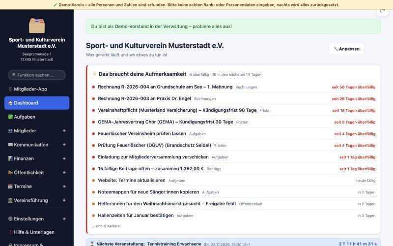
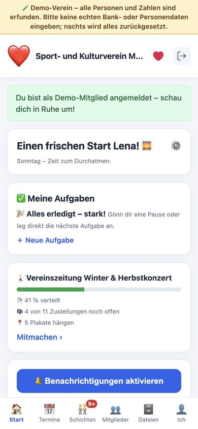

# NETTverwaltet – die Vereinsverwaltung für gemeinnützige Vereine

**Mitglieder, Beiträge, Kasse, Termine, Helfer:innen und eine Mitglieder-App fürs Handy – an einem Ort,
auf Deutsch, ohne Abo und ohne Lizenzgebühren.** Ihr betreibt die Software selbst: auf einem eigenen Rechner
oder auf einem kleinen Server. Eure Daten bleiben bei euch.

NETTverwaltet ist ehrenamtlich beim gemeinnützigen Verein WerkHausWaren e.V. in Waren (Müritz) entstanden
und wird dort jeden Tag benutzt. Jetzt kann jeder Verein sie kostenlos einsetzen.

> **Erst einmal reinschauen?** Probiert die Demo mit erfundenen Beispieldaten aus:
> **https://verein.nettverwaltet.de** → „Demo ausprobieren“. Die Demo wird jede Nacht zurückgesetzt –
> ihr könnt also nichts kaputt machen.

  
  &nbsp;
  

<em>Links die Verwaltung für den Vorstand, rechts die Mitglieder-App – alle Daten im Bild sind erfunden.</em>

---

## Was die Software kann

| Bereich | Was ihr damit macht |
|---|---|
| 👥 **Mitglieder** | Karteikarten mit Kontaktdaten, Gruppen, Suche, Import aus Excel/CSV, Export, Mitgliedsausweis |
| 💶 **Beiträge & SEPA** | Beitragssätze, Lastschriftmandate, SEPA-Lastschrift-Datei für die Bank, Beitragsrechnungen per E-Mail |
| 📒 **Kasse & Finanzen** | Einnahmen und Ausgaben mit Belegen, Kontenrahmen für Gemeinnützige (vier Sphären), Kassenbericht, Kontoauszug-Archiv |
| 🏦 **Bank** | Umsätze per Online-Banking-Schnittstelle (FinTS) abrufen und zuordnen, Saldo-Abgleich |
| 🧾 **Spenden** | Spenden erfassen, Zuwendungsbestätigungen erstellen, Spendenaktionen |
| 📅 **Termine & Veranstaltungen** | Kalender, Anmeldungen mit Warteliste, Tickets mit QR-Code, Einlass-Kontrolle per Handy |
| 🙋 **Helfer:innen** | Schichtpläne mit Rollen, Erinnerungen, Selbst-Eintragen in der App |
| 📨 **Kommunikation** | Rundmails an Gruppen, Vorlagen, Pressemitteilungen und Presseverteiler |
| 📱 **Mitglieder-App** | Installierbare App fürs Handy (ohne App-Store): Termine, Merkzettel, Schichten, eigene Daten, Push-Mitteilungen |
| 📺 **Bildschirme im Haus** | Alte iPads oder Fernseher zeigen automatisch Programm, Aufsteller vor Räumen und einen Selbst-Check-in |
| 🗂️ **Unterlagen** | Satzung, Protokolle und Bescheide zentral ablegen; Datensicherung |
| 🔐 **Sicherheit** | Anmeldung mit Passwort, Zwei-Faktor oder Face ID/Fingerabdruck, Rollen und Rechte, verschlüsselte Zugangsdaten |

Vieles lässt sich ein- und ausschalten, damit nur das sichtbar ist, was euer Verein braucht.
Eine genauere Übersicht steht in [docs/04-funktionen.md](docs/04-funktionen.md).

---

## So setzt ihr NETTverwaltet ein

| Weg | Für wen | Aufwand |
|---|---|---|
| **1. Demo ansehen** | alle, die erst schauen wollen | 1 Minute, nur ein Browser |
| **2. Auf dem eigenen Rechner** | eine Person (z. B. Kasse) verwaltet alles allein | ca. 10 Minuten, Doppelklick |
| **3. Auf einem eigenen Server** | der Vorstand arbeitet gemeinsam, Mitglieder nutzen die App | ca. 30–60 Minuten, Server ab ca. 5 € im Monat |

👉 **Unsicher, ob es passt?** Lest zuerst [Ist das was für uns?](docs/00-ist-das-was-fuer-uns.md)

Die Anleitungen Schritt für Schritt:

1. [Ist das was für uns?](docs/00-ist-das-was-fuer-uns.md)
2. [Ausprobieren – Demo und eigener Rechner](docs/01-ausprobieren.md)
3. [Online betreiben – auf einem eigenen Server](docs/02-online-betreiben.md)
4. [Erste Schritte nach der Einrichtung](docs/03-erste-schritte.md)
5. [Was die Software alles kann](docs/04-funktionen.md)
6. [Datenschutz im Verein](docs/05-datenschutz.md)
7. [Sichern und aktualisieren](docs/06-sichern-und-aktualisieren.md)
8. [Hilfe bei Problemen](docs/07-hilfe.md)
9. [Kleines Technik-Wörterbuch](docs/08-glossar.md)

Für Technik-Interessierte: [Aufbau der Software und Mitmachen](docs/entwicklung.md).

---

## Gut zu wissen

- **Kostenlos und frei:** NETTverwaltet steht unter der [GNU AGPL 3.0](LICENSE). Ihr dürft die Software nutzen,
  verändern und weitergeben. Wer eine veränderte Fassung für andere im Internet betreibt, muss den geänderten
  Quellcode ebenfalls offenlegen.
- **Ohne Gewähr:** Die Software wird ehrenamtlich gepflegt. Es gibt keinen bezahlten Support und keine Garantie.
  Sichert eure Daten regelmäßig (siehe [Sichern und aktualisieren](docs/06-sichern-und-aktualisieren.md)).
- **Datenschutz:** Für die Daten eurer Mitglieder ist euer Verein verantwortlich. Was das praktisch bedeutet,
  steht in [Datenschutz im Verein](docs/05-datenschutz.md) – das ersetzt aber keine Rechtsberatung.
- **Fragen und Ideen:** über die Reiter „Issues“ und „Discussions“ hier auf GitHub. Sicherheitslücken bitte
  **nicht** öffentlich melden, sondern wie in [SECURITY.md](SECURITY.md) beschrieben.

## Unterstützen

NETTverwaltet ist ehrenamtlich entstanden. Wenn sie eurem Verein hilft, freut sich WerkHausWaren e.V. über eine
freiwillige Spende: **https://paypal.me/werkhauswaren** – ohne Gegenleistung, die Software bleibt so oder so
kostenlos.

Bildnachweise und verwendete Bausteine anderer Projekte: [NOTICE.md](NOTICE.md).

---

**Herausgeber:** WerkHausWaren e.V., Werderweg 4D, 17192 Waren (Müritz), Deutschland ·
Projektseite: https://github.com/WerkHausWaren/NETTverwaltet
