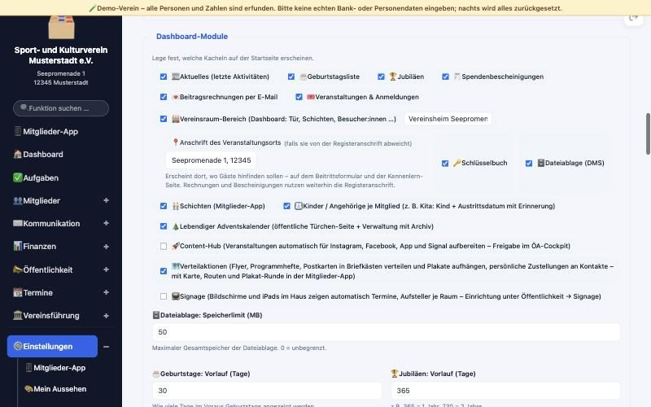
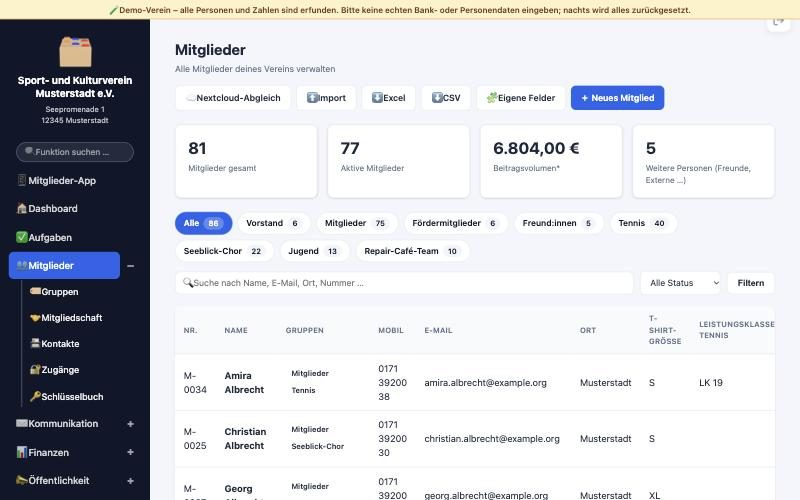
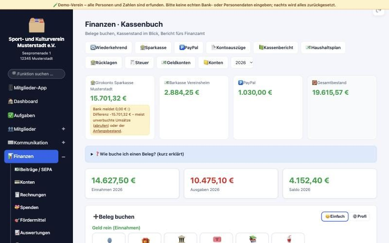
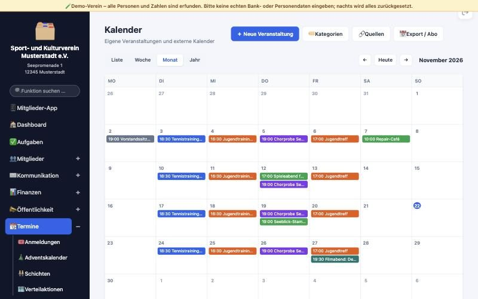
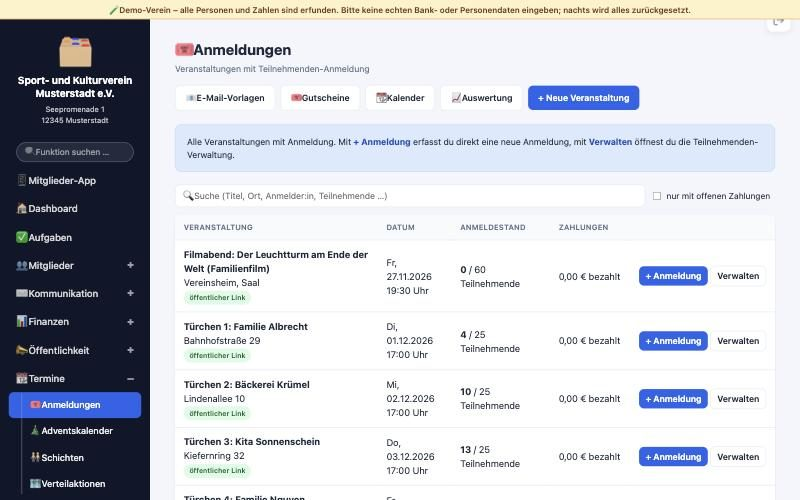
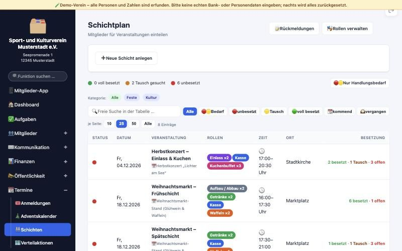
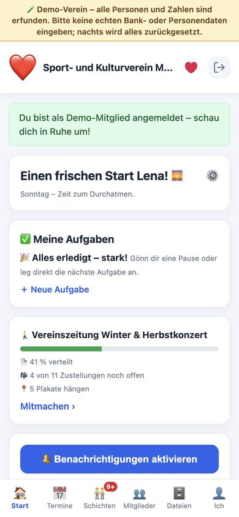
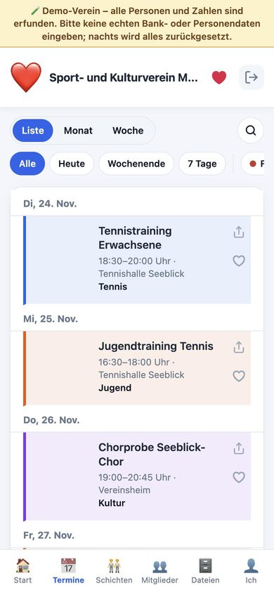

# Was die Software alles kann

Eine Übersicht nach Bereichen, so wie sie links im Menü stehen. Mit 🔌 markierte Bereiche sind **Module**:
Sie lassen sich unter **Einstellungen → Dashboard-Module** ein- und ausschalten.

## Mitglieder

- **Mitglieder**: Karteikarten, Suche, Filter, Import und Export (Excel, CSV), Mitgliedsausweis mit Foto
- **🏷️ Gruppen**: Verteiler und Rollen im Verein
- **🤝 Mitgliedschaft**: Online-Beitrittsformular mit Bestätigung durch den Vorstand, Austritte
- **📇 Kontakte**: Partner:innen, Presse, Förderer – alle, die keine Mitglieder sind (Import auch aus vCard)
- **🔐 Zugänge**: Konten und Rechte für den Vorstand und die Mitglieder-App
- 🔌 **Geburtstage** und **Jubiläen** auf dem Dashboard
- 🔌 **🔑 Schlüsselbuch**: wer hat welchen Schlüssel oder Code

## Kommunikation

- **Rundmails** an Gruppen mit Platzhaltern („Liebe …“), Vorlagen und persönlichem Absender
- **📣 Ankündigungen** und **📌 Schwarzes Brett** in der Mitglieder-App
- **🖨️ Listen & Serienbriefe** als PDF, z. B. Adressetiketten
- **Push-Mitteilungen** aufs Handy – jede Person wählt selbst, welche Themen sie bekommt

## Finanzen

- **💶 Beiträge / SEPA**: Beitragssätze, Mandate, SEPA-Lastschrift-Datei für die Bank
- **Kassenbuch** mit Belegen und Kontenrahmen für gemeinnützige Vereine (ideeller Bereich, Vermögensverwaltung,
  Zweckbetrieb, wirtschaftlicher Geschäftsbetrieb), **💳 Konten**, Kassenbericht, Kontoauszüge nach Geschäftsjahr
- **Bankabruf** per Online-Banking (FinTS) – jede Person mit eigenem Bankzugang
- 🔌 **🧾 Rechnungen**: Beitragsrechnungen per E-Mail
- 🔌 **💝 Spenden**: Spenden erfassen, Zuwendungsbestätigungen, Spendenaktionen mit eigener Spendenseite
- **🎯 Fördermittel**: Förderprogramme, Anträge, Fristen und Verwendungsnachweise
- **📈 Auswertungen**: Mitgliederentwicklung, Beiträge, Spenden, App-Nutzung

## Öffentlichkeitsarbeit

- **📋 Redaktionsplan**, **🪄 Beitrags-Werkstatt** und **📇 Presseverteiler** für Pressemitteilungen
- **📸 Fotoarchiv** mit Foto-Einwilligungen
- 🔌 **📺 Signage**: alte iPads und Fernseher als Bildschirme im Haus – Programm im Schaufenster, Aufsteller vor
  Räumen, Selbst-Check-in mit Ticket-QR-Code; mit Folienplan, Feiertagen und Schulferien
- Termine erscheinen auf Wunsch bei Google (Veranstaltungsdaten für Suchmaschinen)

## Veranstaltungen

- **Kalender** mit Listen-, Wochen-, Monats- und Jahresansicht, Kategorien mit Farben, Serientermine
- 🔌 **🎟️ Anmeldungen**: Online-Anmeldung mit Warteliste, Preisen, Gutscheinen, Tickets mit QR-Code,
  Einlass-Kontrolle per Handy und Bericht
- 🔌 **🧑‍🤝‍🧑 Schichten**: Helfer:innen-Planung mit Rollen und Erinnerungen
- 🔌 **🗺️ Verteilaktionen**: Flyer und Plakate straßenweise verteilen
- 🔌 **🎄 Adventskalender**: öffentliche Türchen-Seite für einen „Lebendigen Adventskalender“
- **⏰ Fristen-Radar**: wichtige Termine des Vereins im Blick

## Verein

- **📜 Vereinsunterlagen**: Satzung, Registerauszug, Freistellungsbescheid, Protokolle
- 🔌 **🗄️ Dateiablage** mit Ordnern und Freigaben
- **💾 Datensicherung** mit Wiederherstellen

## Mitglieder-App (fürs Handy)

 &nbsp; 

Termine mit Merkzettel und Anmeldung, eigene Schichten, eigene Daten ändern, Ankündigungen, Dokumente,
Push-Mitteilungen. Die App lässt sich in mehreren Sprachen anzeigen und funktioniert ohne App-Store.

## Für Fortgeschrittene

Anbindung einer eigenen **Nextcloud** (Anmeldung, Kalender, Adressbuch), mehrere Vereine auf einem Server,
Instagram-Verbindung und ein Content-Hub für Social Media. Diese Funktionen brauchen zusätzliche Einrichtung und
sind ab Werk ausgeschaltet.
